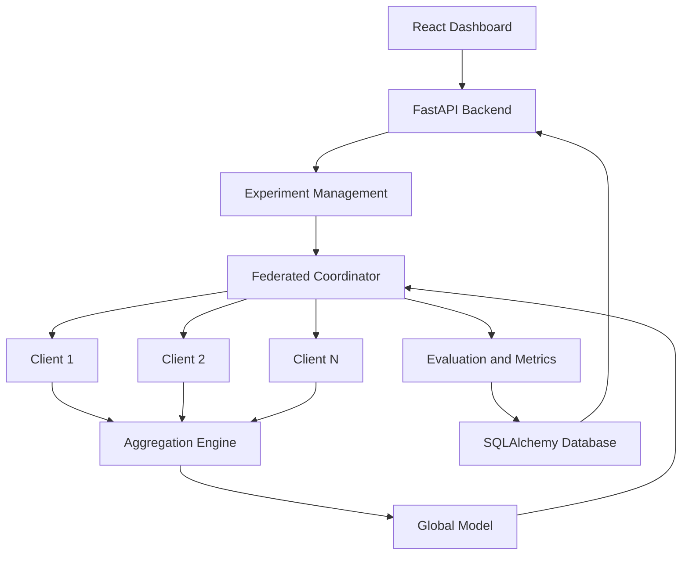

# FedLearn — System Architecture

## 1. Project Overview

FedLearn is a federated learning research platform developed using PyTorch, FastAPI, React, SQLAlchemy, and Docker Compose.

Its objective is to enable collaborative model training without centrally collecting raw client training datasets.

The platform supports simulated federated learning and network-connected client execution.

## 2. High-Level Architecture

The coordinator orchestrates training, aggregation, and evaluation. In network-connected execution, client processes communicate with the coordinator over the network.

## 3. Main Components

### 3.1 React Dashboard

The React and Vite frontend provides an interface for experiment configuration, execution, and monitoring.

The dashboard displays experiment information and evaluation metrics, including accuracy, loss, and Macro F1.

Available experiment actions depend on the backend configuration and supported execution modes.

### 3.2 FastAPI Backend

The backend handles:

- Experiment configuration and validation
- Experiment lifecycle management
- API endpoints
- Database operations
- Experiment status and result retrieval

### 3.3 Federated Coordinator

The coordinator manages:

- Global model initialization
- Client selection and participation
- Global model distribution
- Client update collection
- Aggregation
- Global model evaluation
- Communication-round orchestration
- Round-level metrics

The implementation includes local and remote coordinator modules.

### 3.4 Federated Clients

Each client:

1. Receives the current global model.
2. Trains the model using its local dataset.
3. Computes local training metrics.
4. Returns updated model parameters and metadata.

Raw training examples are not included in the normal model-update exchange.

### 3.5 Aggregation Engine

FedLearn implements two aggregation methods.

#### Federated Averaging (FedAvg)

FedAvg computes aggregation weights based on local sample counts:

\[
w_k=\frac{n_k}{\sum_j n_j}
\]

#### Adaptive Aggregation

FedLearn's adaptive aggregation computes:

\[
s_k=n_k\max(a_k,\epsilon)
\]

\[
w_k=\frac{s_k}{\sum_j s_j}
\]

where:

- \(n_k\) is the client's training sample count.
- \(a_k\) is the client's local training accuracy.
- \(\epsilon=10^{-6}\) prevents zero-valued accuracy factors.

Floating-point model parameters are aggregated using the normalized weights:

\[
\theta_{\mathrm{global}}=\sum_k w_k\theta_k
\]

The implementation performs floating-point accumulation in float64 on CPU before converting the result to the reference parameter dtype.

For compatible non-floating-point state entries, the implementation copies the reference client's value rather than computing a weighted average.

Adaptive aggregation uses local training accuracy, not validation accuracy or a measured network-reliability score.

## 4. Federated Training Workflow

1. An experiment configuration is prepared.
2. The coordinator initializes the global model.
3. Participating clients receive model parameters.
4. Clients perform local training.
5. Clients return model updates and training metadata.
6. The coordinator validates and aggregates the updates.
7. The updated global model is evaluated.
8. Round-level metrics are recorded.
9. The process continues for the configured communication rounds.

## 5. Execution Modes

### 5.1 Simulated Federated Learning

The simulated execution mode supports multiple logical clients on a single machine.

It is used for reproducible experiments with IID and non-IID data partitions.

### 5.2 Network-Connected Federated Learning

The distributed implementation supports independent client processes and network-based model exchange.

The remote coordinator includes round orchestration and client-update collection.

Fault-tolerance and recovery mechanisms were implemented during the distributed-training development phase.

A complete multi-machine deployment should be validated separately before claiming successful production-scale distributed execution.

## 6. Technology Stack

| Layer | Technology |
|---|---|
| Machine Learning | PyTorch |
| Programming Language | Python 3.11 |
| Backend | FastAPI |
| Frontend | React, Vite |
| Database Layer | SQLAlchemy |
| Local Database | SQLite |
| Containerization | Docker Compose |
| Evaluation | Pandas, Matplotlib |
| Testing | Pytest, Vitest |

## 7. Experimental Evaluation

The primary completed evaluation uses Fashion-MNIST.

### Experimental Configuration

- Five clients
- Ten communication rounds
- One local epoch
- FedAvg and Adaptive aggregation
- IID and Dirichlet non-IID partitions
- Dirichlet alpha values of 0.5 and 0.1
- Random seeds 42, 123, and 2026

This produces 18 multi-seed experiments.

### Evaluation Metrics

- Validation accuracy
- Macro F1
- Validation loss
- Convergence across communication rounds
- Mean and standard deviation across random seeds
- Paired differences between aggregation methods

### Research Findings

Both methods achieved approximately 91% mean accuracy under IID partitioning.

Stronger non-IID partitioning reduced mean accuracy and increased variation across seeds.

Adaptive aggregation did not consistently outperform FedAvg in the tested configurations.

Detailed results are available in `docs/final-evaluation-report.md`.

## 8. Database Architecture

FedLearn uses SQLAlchemy for experiment-related persistence.

The documented database model includes experiment records, training-round records, and client-participation records.

### Experiments

Stores experiment identifiers, configuration, status, and creation information.

### Training Rounds

Stores round-level evaluation metrics and execution information.

### Client Participation

Stores participating client information, sample counts, aggregation weights, and available local training metrics.

The exact persisted fields and relationships should be verified against the current SQLAlchemy models before treating this section as a complete database schema reference.

## 9. Privacy and Security Considerations

FedLearn avoids centrally collecting raw client training datasets during the normal federated training workflow.

However, model updates may still expose information about local data.

The current implementation does not establish formal differential privacy or secure aggregation guarantees.

Training accuracy is used to compute adaptive aggregation weights. This should not be interpreted as a privacy guarantee or a validated measure of client trustworthiness.

## 10. Limitations and Future Scope

- Limited experimental client count and communication rounds
- Three random seeds in the completed multi-seed evaluation
- Fashion-MNIST as the primary evaluated dataset
- No formal differential privacy guarantee
- No demonstrated production-scale deployment
- Further evaluation needed for heterogeneous devices and networks
- Additional robustness and aggregation studies would strengthen the research conclusions
