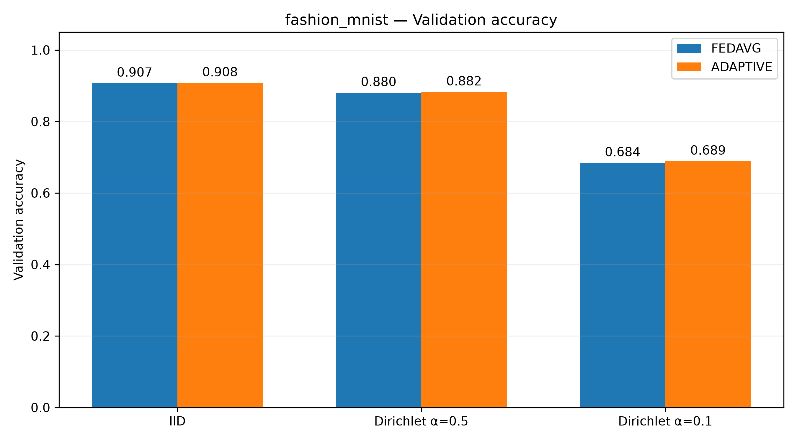
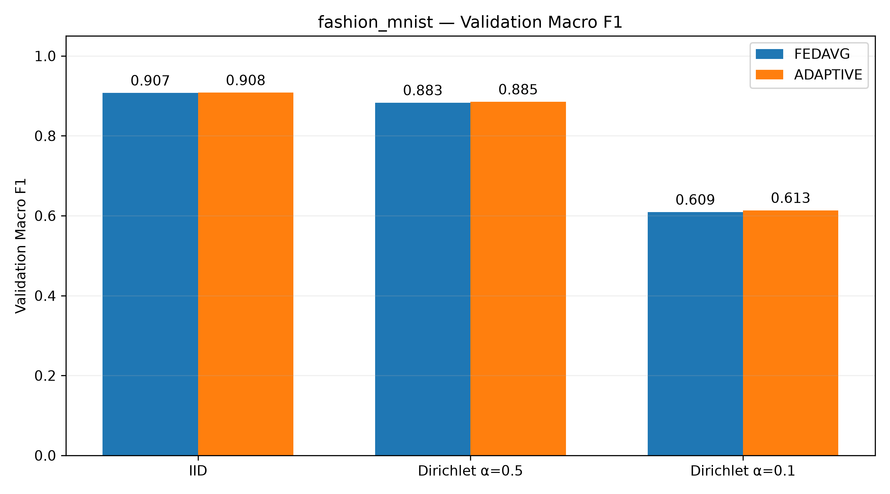
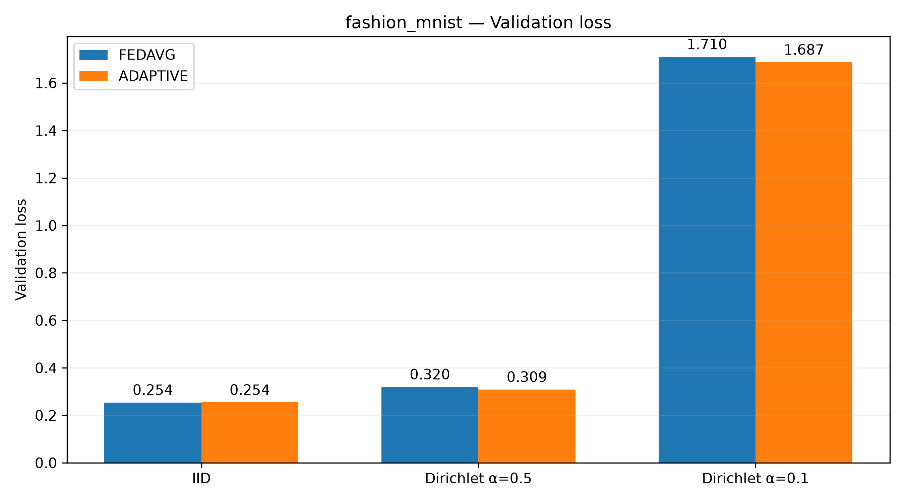
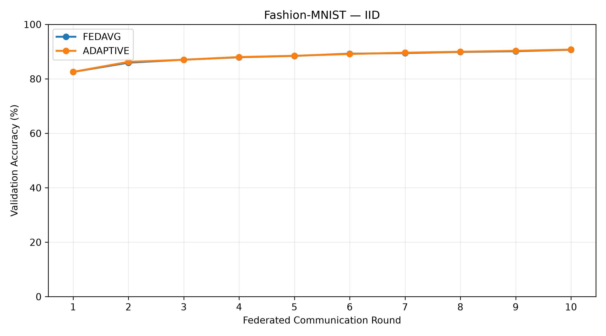
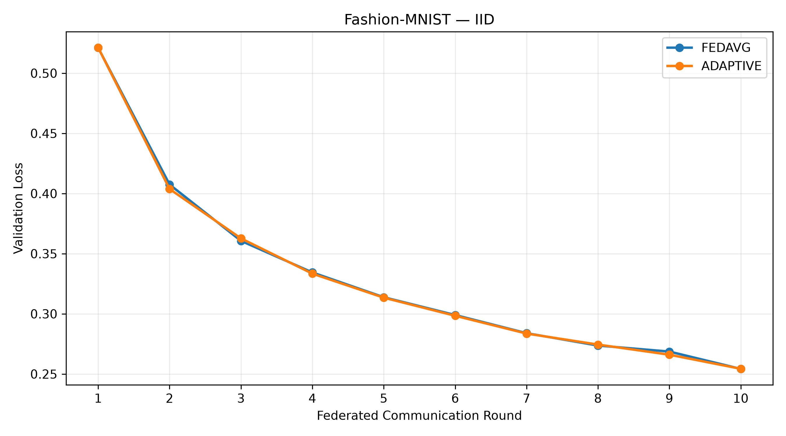
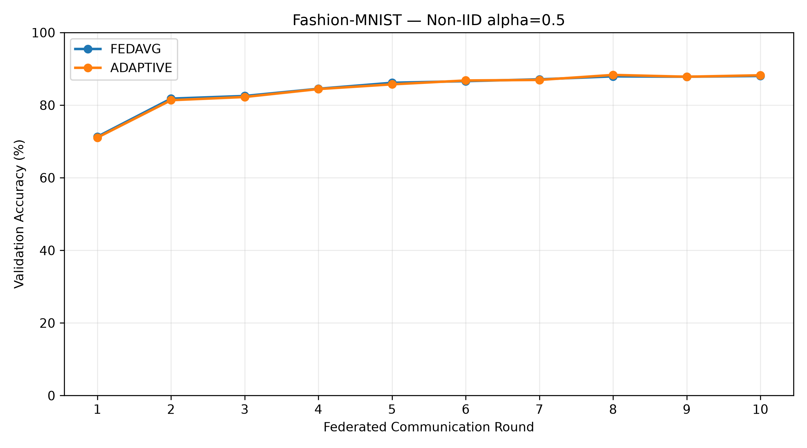
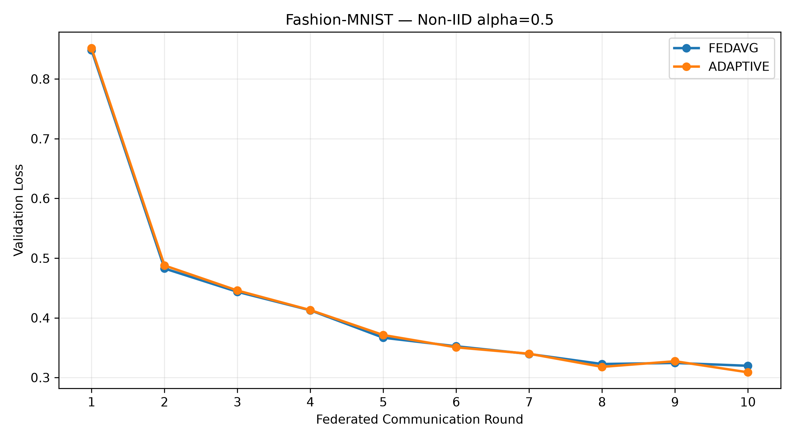
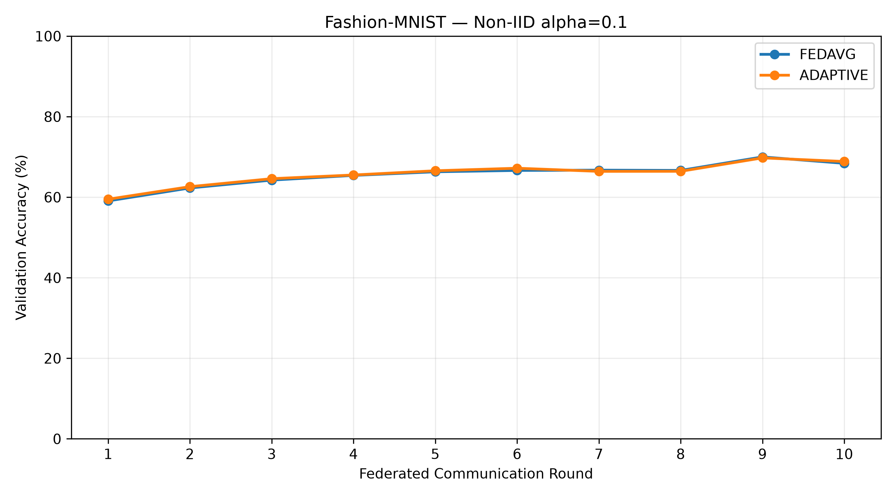
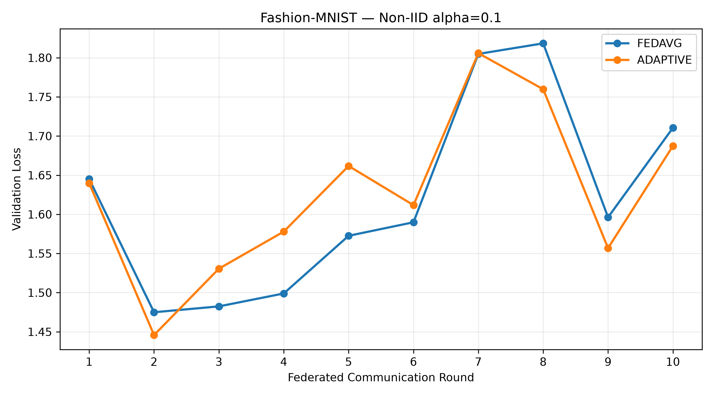

# FedLearn: Final Experimental Evaluation Report

## 1. Introduction

FedLearn is a distributed federated learning platform developed to investigate collaborative machine learning without centralizing raw client training data.

The project implements federated training using PyTorch, a FastAPI backend, network-connected clients, and a React-based monitoring dashboard.

The primary experimental objective is to evaluate how data heterogeneity affects federated model performance and compare Federated Averaging (FedAvg) with an adaptive aggregation approach.

## 2. Research Objectives

The evaluation addresses four questions:

1. How does federated learning perform when client datasets are independently and identically distributed (IID)?
2. How does increasing data heterogeneity affect accuracy, Macro F1, and validation loss?
3. Does adaptive aggregation improve performance compared with FedAvg?
4. How consistent are the experimental findings across different random seeds?

## 3. Experimental Methodology

### 3.1 Dataset

The primary evaluation uses Fashion-MNIST, a dataset containing grayscale clothing images from 10 classification categories.

PneumoniaMNIST is supported by the platform's dataset pipeline but is not included in the reported 18-run multi-seed evaluation.

### 3.2 Federated Configuration

| Parameter | Value |
|---|---|
| Dataset | Fashion-MNIST |
| Number of clients | 5 |
| Communication rounds | 10 |
| Local epochs | 1 |
| Aggregation methods | FedAvg, Adaptive |
| Data distributions | IID, Dirichlet alpha=0.5, alpha=0.1 |
| Random seeds | 42, 123, 2026 |
| Total experiments | 18 |
| Execution device | CPU |

Each aggregation method was evaluated under three data distributions using three random seeds.

### 3.3 Data Partitioning

**IID:** Training data is distributed approximately uniformly among clients.

**Dirichlet alpha=0.5:** Client datasets exhibit moderate label-distribution heterogeneity.

**Dirichlet alpha=0.1:** Client datasets exhibit stronger label-distribution heterogeneity.

Smaller Dirichlet concentration parameters generally produce more uneven client label distributions.

### 3.4 Aggregation Methods

**Federated Averaging (FedAvg):** Aggregates client model updates using client data-size weighting.

**Adaptive aggregation:** Uses the platform's implemented adaptive aggregation strategy to combine client updates.

The experiments compare the observed outcomes of these implementations rather than assuming either approach is superior.

## 4. Evaluation Metrics

- Accuracy: Proportion of correctly classified validation samples.
- Macro F1: Unweighted mean of the F1 scores across classes.
- Validation loss: Model loss on evaluation data.
- Standard deviation: Variation in results across three random seeds.
- Paired accuracy difference: Adaptive accuracy minus FedAvg accuracy for matching seeds.
- Convergence: Changes in validation accuracy and loss across communication rounds.

## 5. Multi-Seed Experimental Results

### 5.1 Accuracy and Macro F1

Values are mean ± sample standard deviation for accuracy, and mean Macro F1.

| Distribution | Aggregation | Accuracy (%) | Macro F1 |
|---|---|---:|---:|
| IID | FedAvg | 90.84 ± 0.20 | 0.9085 |
| IID | Adaptive | 90.91 ± 0.13 | 0.9092 |
| Dirichlet alpha=0.5 | FedAvg | 88.66 ± 0.67 | 0.8870 |
| Dirichlet alpha=0.5 | Adaptive | 88.65 ± 0.43 | 0.8870 |
| Dirichlet alpha=0.1 | FedAvg | 76.08 ± 8.28 | 0.7195 |
| Dirichlet alpha=0.1 | Adaptive | 75.99 ± 8.43 | 0.7178 |

### 5.2 Validation Loss

| Distribution | FedAvg | Adaptive |
|---|---:|---:|
| IID | 0.2535 | 0.2535 |
| Dirichlet alpha=0.5 | 0.3062 | 0.3057 |
| Dirichlet alpha=0.1 | 0.9085 | 0.9066 |

These values represent mean final validation loss across three seeds.

### 5.3 Paired Accuracy Comparison

The paired difference is calculated as:

Adaptive accuracy - FedAvg accuracy

| Distribution | Mean difference (percentage points) | SD of difference |
|---|---:|---:|
| IID | +0.0611 | 0.0918 |
| Dirichlet alpha=0.5 | -0.0056 | 0.2496 |
| Dirichlet alpha=0.1 | -0.0889 | 0.9190 |

Positive values favor Adaptive; negative values favor FedAvg.

The observed differences are small compared with the variation under strong non-IID partitioning.

No claim of statistical significance is made because the evaluation uses only three paired seeds and does not establish a statistically significant advantage.

## 6. Discussion

### 6.1 IID Performance

Under IID partitioning, both aggregation methods achieved approximately 91% mean accuracy.

The small difference between the methods suggests comparable performance in the tested IID configuration.

### 6.2 Moderate Non-IID Performance

At Dirichlet alpha=0.5, mean accuracy decreased to approximately 88.65%.

The methods produced nearly identical mean accuracy, indicating no meaningful observed advantage for either method in this configuration.

### 6.3 Strong Non-IID Performance

At Dirichlet alpha=0.1, mean accuracy decreased to approximately 76%.

Accuracy standard deviation increased to more than eight percentage points for both methods.

This indicates substantial sensitivity to the random seed and resulting data partition under stronger heterogeneity.

### 6.4 Aggregation Comparison

Adaptive aggregation did not consistently outperform FedAvg.

Its mean accuracy was slightly higher under IID partitioning but slightly lower under both non-IID settings.

The results do not support a general claim that adaptive aggregation is more accurate than FedAvg.

## 7. Convergence Evaluation

Round-level metrics were recorded for the 10 communication rounds.

Convergence plots compare FedAvg and Adaptive under:

- IID partitioning
- Dirichlet alpha=0.5
- Dirichlet alpha=0.1

The plots provide a visual basis for comparing changes in validation accuracy and loss over training rounds.

The existence of the plots has been verified, but their shapes and trends require visual inspection before drawing detailed conclusions about convergence speed or instability.

## 8. Visualizations

### Final Accuracy Comparison

### Macro F1 Comparison

### Validation Loss Comparison

### IID Accuracy Convergence

### IID Loss Convergence

### Moderate Non-IID Accuracy Convergence

### Moderate Non-IID Loss Convergence

### Strong Non-IID Accuracy Convergence

### Strong Non-IID Loss Convergence

## 9. Limitations

1. The multi-seed evaluation includes only three random seeds.
2. Experiments use five clients and ten communication rounds.
3. Fashion-MNIST is the primary evaluated dataset.
4. Results may differ under other model architectures, local epochs, client counts, or partition parameters.
5. CPU-based experiments do not establish performance on larger distributed infrastructure.
6. Federated learning does not automatically provide differential privacy or secure aggregation guarantees.
7. The evaluation does not establish statistically significant superiority of either aggregation method.

## 10. Future Scope

Potential extensions include:

- Increasing the number of random seeds
- Evaluating more clients and communication rounds
- Testing additional datasets and model architectures
- Investigating differential privacy and secure aggregation
- Studying communication overhead and network latency
- Evaluating client dropout under more diverse network conditions
- Comparing additional aggregation strategies

## 11. Conclusion

FedLearn demonstrates a functional federated learning platform with support for multiple aggregation strategies, heterogeneous client data distributions, distributed execution, and experiment monitoring.

The 18-run Fashion-MNIST evaluation shows that increasing data heterogeneity is associated with reduced classification performance and greater variation across seeds.

Both FedAvg and Adaptive achieved similar accuracy under IID and moderately non-IID conditions. Under strongly non-IID partitioning, performance declined substantially and became less consistent.

Adaptive aggregation did not demonstrate a consistent accuracy advantage over FedAvg in the tested configurations.

These findings highlight the importance of evaluating federated learning systems under heterogeneous data distributions and multiple random seeds rather than relying on a single experimental run.
